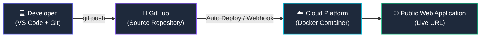

# Practical 2: Dockerization and Cloud Deployment of a Node.js Web Application

**Course:** TPDS — Module 4  
**Topic:** Docker & Cloud Deployment  
**Author:** Bhavya | B.Tech Computer Science  

---

## 🎯 Aim
Develop a Node.js and Express.js web application, containerize it using Docker, and deploy it to a cloud platform.

## 📌 Problem Statement
Develop a **Student Task Management Web Application** that allows students to create, view, update, and delete tasks. Containerize the application using Docker and deploy it to a cloud hosting platform.

---

## 🏗️ Deployment Architecture



---

## ✅ Functional Requirements Compliance Checklist

| # | Requirement | Status | Implementation Details |
|---|---|:---:|---|
| **1** | Develop a responsive Task Management application | ✅ **Done** | SPA with responsive sidebar, stats grid, task cards, category badges, priority indicators, and modals (`public/index.html`, `public/css/app.css`, `public/js/app.js`) |
| **2** | Create a Node.js server using Express.js | ✅ **Done** | Express 4.x server with CORS, JSON body parser, and static assets in [`server.js`](server.js) |
| **3** | Implement REST API endpoints for CRUD operations | ✅ **Done** | Full CRUD: GET (with filters & sort), POST, PUT, PATCH, DELETE, plus `/api/stats` and `/health` |
| **4** | Store tasks using a database or persistent storage | ✅ **Done** | Persistent JSON store in `data/tasks.json` with Docker volume mount support |
| **5** | Create a Dockerfile for the application | ✅ **Done** | Multi-stage production build using `node:20-alpine`, non-root user `appuser`, healthcheck instruction, and `.dockerignore` |
| **6** | Build a Docker image using `docker build` | ✅ **Done** | Image built successfully: `taskflow:latest` |
| **7** | Run the application inside a Docker container | ✅ **Done** | Container `taskflow-app` runs successfully in background |
| **8** | Test the application locally through port mapping | ✅ **Done** | Port mapping `3000:3000` tested; API and frontend fully functional on `http://localhost:3000` |
| **9** | Push the source code to GitHub | ⏳ **Ready** | Local Git commits clean; add remote origin and push (see guide below) |
| **10** | Deploy the Dockerized application on a cloud platform & verify public URL | ⏳ **Ready** | Ready for 1-click deployment on Render / Railway / Azure (instructions below) |

---

## 📁 Project Structure

```
Practical_2/
├── server.js              # Express.js REST API server & static server
├── package.json           # Dependencies & scripts
├── package-lock.json      # Dependency lockfile for reproducible builds
├── Dockerfile             # Multi-stage Docker image definition
├── docker-compose.yml     # Multi-container / volume compose specification
├── .dockerignore          # Build context exclusions (node_modules, logs)
├── .gitignore             # Git ignored files
├── README.md              # Documentation & guide
├── data/
│   └── tasks.json         # Persistent JSON file storage
└── public/
    ├── index.html         # Responsive frontend SPA
    ├── css/
    │   └── app.css        # Modern dark theme & responsive styles
    └── js/
        └── app.js         # Frontend controller & REST API client
```

---

## 🛠️ REST API Specification

| Method | Endpoint | Query / Body Params | Description |
|---|---|---|---|
| `GET` | `/api/tasks` | `status`, `priority`, `category` | Retrieve all tasks with optional filters |
| `GET` | `/api/tasks/:id` | — | Retrieve a single task by UUID |
| `POST` | `/api/tasks` | `{ title, description, priority, dueDate, category }` | Create a new task |
| `PUT` | `/api/tasks/:id` | `{ title, description, priority, status, dueDate, category }` | Update entire task |
| `PATCH` | `/api/tasks/:id/status` | `{ status: "pending" \| "in-progress" \| "completed" }` | Quick status change |
| `DELETE` | `/api/tasks/:id` | — | Delete a task |
| `GET` | `/api/stats` | — | Retrieve dashboard metrics (counts & status) |
| `GET` | `/health` | — | Docker & Cloud container health status |

---

## 🐳 Docker Execution Guide

### 1. Build the Docker Image
```bash
docker build -t taskflow:latest .
```

### 2. Run Container with Port Mapping
```bash
docker run -d -p 3000:3000 --name taskflow-app taskflow:latest
```

### 3. Verify Container Status & Logs
```bash
# Check running container
docker ps

# Inspect logs
docker logs -f taskflow-app

# Health check
curl http://localhost:3000/health
```

### 4. Stop and Clean Up Container
```bash
docker stop taskflow-app && docker rm taskflow-app
```

---

## 🚀 Steps for Cloud Submission (Requirements 9 & 10)

### Step A: Push Source Code to GitHub (Requirement 9)
1. Create a new GitHub repository named `tpds-practical-2` or `student-task-manager` at [github.com/new](https://github.com/new).
2. Link your local repository and push:
```bash
cd d:\TPDS_Module_4\Practical_2
git remote add origin https://github.com/<your-username>/<your-repo-name>.git
git branch -M main
git push -u origin main
```

### Step B: Deploy to Cloud Platform (Requirement 10)

#### Option: Render.com (Recommended — Free & Automatic Docker Detection)
1. Sign in to [Render.com](https://render.com) using your GitHub account.
2. Click **New +** > **Web Service**.
3. Select your GitHub repository (`tpds-practical-2`).
4. Render will detect the `Dockerfile` automatically:
   - **Name:** `student-task-manager`
   - **Environment:** Docker
   - **Instance Type:** Free
5. Click **Create Web Service**.
6. Once deployed, Render will provide a public HTTPS URL:
   `https://student-task-manager-xxxx.onrender.com`
7. Test the health endpoint: `https://student-task-manager-xxxx.onrender.com/health`.

---

## 👤 Author
**Bhavya** | B.Tech Computer Science  
Module 4 — Practical 2: Dockerization & Cloud Deployment
